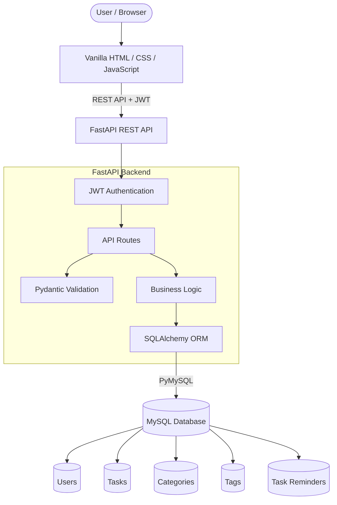
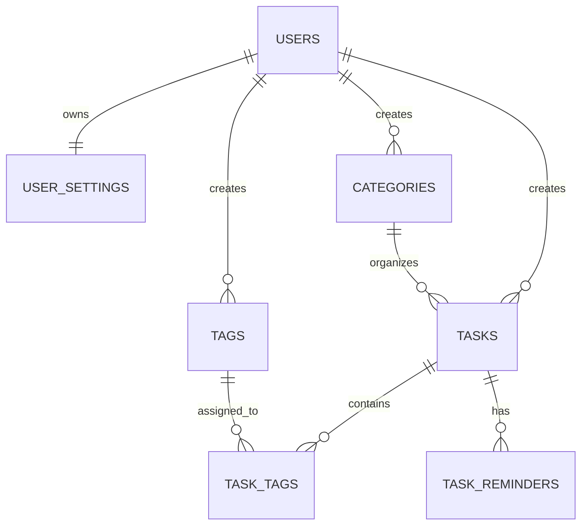
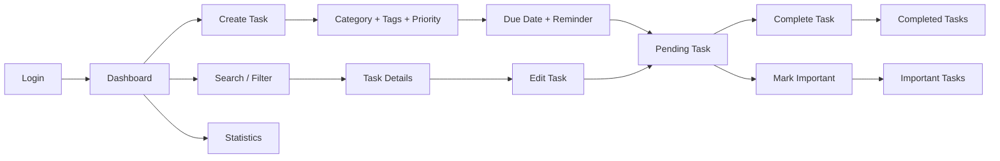

# 📝 TaskFlow — Full-Stack Task Management Application

[](https://python.org)
[](https://fastapi.tiangolo.com)
[](https://www.sqlalchemy.org)
[](https://www.mysql.com)
[](https://developer.mozilla.org/en-US/docs/Web/JavaScript)
[]()

**TaskFlow** is a modern full-stack task and productivity management application designed to provide authenticated users with a structured and efficient way to create, organize, track, and complete daily tasks. The application combines a **FastAPI REST backend**, **SQLAlchemy ORM**, **MySQL relational database**, and a **responsive vanilla HTML5/CSS3/JavaScript frontend** to provide a complete task-management workflow.

TaskFlow goes beyond basic CRUD functionality by implementing JWT-based authentication, bcrypt password hashing, authorization, task priorities, due dates, categories, tags, reminders, search, filtering, sorting, important-task management, completion tracking, statistics, user settings, responsive layouts, light/dark themes, loading states, toast notifications, dialogs, keyboard shortcuts, and optimized task interactions.

The project demonstrates practical full-stack development across backend API architecture, relational database design, authentication, authorization, validation, frontend/backend integration, responsive UI development, automated testing, and secure application organization.

---

## 📑 Table of Contents

- [Architectural Overview](#-architectural-overview)
- [Key Features](#-key-features)
- [Technology Stack](#-technology-stack)
- [Project Directory Structure](#-project-directory-structure)
- [Database Architecture](#-database-architecture)
- [Environment Variables](#-environment-variables)
- [Local Setup](#-local-setup)
- [Running the Application](#-running-the-application)
- [Interactive API Documentation](#-interactive-api-documentation)
- [REST API Endpoints](#-rest-api-endpoints)
- [Task Workflow](#-task-workflow)
- [Testing](#-testing)
- [Security](#-security)
- [Key Learning Outcomes](#-key-learning-outcomes)
- [Developer](#-developer)
- [License](#-license)

---

## 🏛️ Architectural Overview



---

## ✨ Key Features

### 🔐 Authentication & User Management

- User registration
- User login
- JWT-based authentication
- Secure bcrypt password hashing
- Protected API endpoints
- User-specific task access
- Authorization checks
- User settings management
- Authentication validation

### 📝 Task Management

- Create tasks
- View tasks
- Update tasks
- Delete tasks
- Mark tasks as completed
- Mark tasks as incomplete
- Mark tasks as important
- Set task priorities
- Set due dates
- Add task descriptions
- Assign categories
- Add multiple tags
- Add reminders
- Track pending tasks
- Track completed tasks

### 🔎 Search, Filter & Sort

- Keyword search
- Category filtering
- Tag filtering
- Priority filtering
- Completion filtering
- Important-task filtering
- Due-date filtering
- Sorting
- Status-based organization

### 📊 Dashboard & Statistics

The application provides task statistics such as:

- Total tasks
- Completed tasks
- Pending tasks
- Important tasks
- Priority distribution
- Category organization
- Task completion progress

### 🗂️ Categories & Tags

Tasks can be organized using:

- Custom categories
- Multiple tags
- Task-tag relationships
- Category filtering
- Tag filtering

### ⏰ Reminders

The application supports task reminders and due-date management so users can organize time-sensitive work.

### 🎨 User Interface

- Responsive design
- Mobile-friendly layout
- Desktop-friendly layout
- Light theme
- Dark theme
- System theme support
- List view
- Grid view
- Toast notifications
- Loading skeletons
- Dialogs and confirmation modals
- Keyboard shortcuts
- Optimistic task completion

---

## 🛠️ Technology Stack

| Layer | Technology | Purpose |
|---|---|---|
| Backend | Python 3.11+ / FastAPI | REST API |
| ORM | SQLAlchemy | Database abstraction |
| Database Driver | PyMySQL | MySQL connectivity |
| Database | MySQL / MariaDB-compatible | Data storage |
| Authentication | JWT | Secure authentication |
| Password Security | bcrypt | Password hashing |
| Validation | Pydantic | Request/response validation |
| Frontend | HTML5 / CSS3 / Vanilla JavaScript | Web interface |
| API Docs | Swagger / ReDoc | API documentation |
| Testing | unittest / FastAPI TestClient | API testing |
| Development | VS Code / Git / GitHub | Development workflow |

---

## 📁 Project Directory Structure

```text
QSkills - Task -1/
│
├── backend/
│   ├── app/
│   │   ├── main.py
│   │   ├── database.py
│   │   ├── models.py
│   │   ├── schemas.py
│   │   ├── auth.py
│   │   ├── config.py
│   │   ├── seed.py
│   │   │
│   │   ├── routes/
│   │   │   ├── auth.py
│   │   │   ├── tasks.py
│   │   │   ├── categories.py
│   │   │   ├── tags.py
│   │   │   ├── reminders.py
│   │   │   └── users.py
│   │   │
│   │   └── utils/
│   │       ├── security.py
│   │       └── helpers.py
│   │
│   └── tests/
│
├── frontend/
│   ├── index.html
│   ├── css/
│   ├── js/
│   └── assets/
│
├── schema.sql
├── seed_data.sql
├── requirements.txt
├── .gitignore
└── README.md
```

---

## 🗄️ Database Architecture

TaskFlow uses a relational MySQL database.

### Core Tables

#### `users`

Stores registered user accounts, authentication information, and account metadata.

#### `user_settings`

Stores user-specific preferences such as theme and notification settings.

#### `tasks`

Stores:

- Task ID
- User ID
- Title
- Description
- Completion status
- Important status
- Priority
- Due date
- Category
- Created timestamp
- Updated timestamp

#### `categories`

Stores user task categories.

#### `tags`

Stores reusable task tags.

#### `task_tags`

Provides the many-to-many relationship between tasks and tags.

#### `task_reminders`

Stores reminders associated with tasks.

### Database Relationship Diagram



---

## ⚙️ Environment Variables

Create a local `.env` file for configuration.

Example:

```ini
DB_HOST=127.0.0.1
DB_PORT=3306
DB_USER=root
DB_PASSWORD=
DB_NAME=taskflow

SECRET_KEY=your_secret_key
ALGORITHM=HS256
ACCESS_TOKEN_EXPIRE_MINUTES=1440

APP_HOST=127.0.0.1
APP_PORT=8000
```

> **Important:** Never commit the actual `.env` file, database password, or JWT secret to GitHub.

---

## 🚀 Local Setup

### 1. Start MySQL

Start MySQL through XAMPP, WAMP, MySQL Server, or another MySQL installation.

Default port:

```text
3306
```

### 2. Create Database

```sql
CREATE DATABASE taskflow;
```

Import the provided:

```text
schema.sql
```

and, if required:

```text
seed_data.sql
```

### 3. Create Virtual Environment

Windows:

```bash
python -m venv venv
venv\Scripts\activate
```

Linux/macOS:

```bash
python3 -m venv venv
source venv/bin/activate
```

### 4. Install Dependencies

```bash
python -m pip install -r requirements.txt
```

### 5. Configure `.env`

Configure your local MySQL credentials and JWT secret.

---

## 💻 Running the Application

Run the backend with Uvicorn:

```bash
uvicorn backend.app.main:app --host 127.0.0.1 --port 8000 --reload
```

If the project supports direct execution:

```bash
python backend/app/main.py
```

### Application

```text
http://127.0.0.1:8000/
```

---

## 📚 Interactive API Documentation

FastAPI automatically provides API documentation.

### Swagger UI

```text
http://127.0.0.1:8000/docs
```

Swagger allows developers to:

- View API endpoints
- Inspect schemas
- Test requests
- Authenticate using Bearer tokens
- Inspect API responses

### ReDoc

```text
http://127.0.0.1:8000/redoc
```

---

## 📡 REST API Endpoints

> The `/docs` endpoint is the authoritative API reference for the current implementation.

### Authentication

```text
POST /api/auth/register
POST /api/auth/login
GET  /api/auth/me
```

### Tasks

```text
GET    /api/tasks
POST   /api/tasks
GET    /api/tasks/{id}
PUT    /api/tasks/{id}
DELETE /api/tasks/{id}
```

### Task Actions

```text
PATCH /api/tasks/{id}/complete
PATCH /api/tasks/{id}/important
```

### Categories

```text
GET    /api/categories
POST   /api/categories
PUT    /api/categories/{id}
DELETE /api/categories/{id}
```

### Tags

```text
GET    /api/tags
POST   /api/tags
PUT    /api/tags/{id}
DELETE /api/tags/{id}
```

### Reminders

```text
GET    /api/reminders
POST   /api/reminders
PUT    /api/reminders/{id}
DELETE /api/reminders/{id}
```

### User Settings

```text
GET /api/users/me/settings
PUT /api/users/me/settings
```

---

## 🔄 Task Workflow



---

## 🧪 Testing

The project includes automated backend/API tests covering important application functionality.

Testing areas include:

- Registration
- Login
- Authentication
- Authorization
- Task creation
- Task retrieval
- Task updates
- Task deletion
- Completion
- Validation
- Protected endpoints
- User-specific access
- API responses

Run unittest:

```bash
python -m unittest
```

If pytest is configured:

```bash
pytest -v
```

---

## 🛡️ Security

### Password Security

Passwords are hashed using bcrypt before storage.

### JWT Authentication

Protected API requests use JWT Bearer authentication.

```text
Login
  ↓
JWT Token
  ↓
Authorization Header
  ↓
Protected Endpoint
  ↓
Token Validation
  ↓
Authorized Request
```

### Authorization

Users are restricted to resources they are authorized to access.

### Input Validation

Pydantic schemas validate incoming API data.

### Database Security

SQLAlchemy ORM is used for database operations and helps prevent unsafe SQL construction.

### Environment Security

Sensitive credentials remain inside `.env` and should not be committed to GitHub.

---

## ⚡ Performance & UX

TaskFlow includes:

- Optimistic completion interactions
- Loading skeletons
- Toast notifications
- Efficient filtering
- Search functionality
- Responsive layouts
- API-based frontend/backend communication
- Database-backed organization

---

## 💡 Key Learning Outcomes

This project demonstrates practical experience with:

- Full-stack development
- FastAPI
- Python
- SQLAlchemy
- MySQL
- REST API design
- JWT authentication
- bcrypt
- CRUD operations
- Database relationships
- Pydantic validation
- Vanilla JavaScript
- Responsive UI development
- Search and filtering
- Task organization
- Automated testing
- Git and GitHub
- Environment configuration
- Application security

---

## 👨‍💻 Developer

**Saksham Pandey**

**BS-MS in Artificial Intelligence and Cybersecurity**  
**IIT Patna**

GitHub:  
https://github.com/sakshampandey380

LinkedIn:  
https://www.linkedin.com/in/saksham-pandey-184515250/

---

## 📜 License

This project was developed as part of a **Full-Stack Development Internship / QSkills Assessment** and is intended for educational, demonstration, and portfolio purposes.
